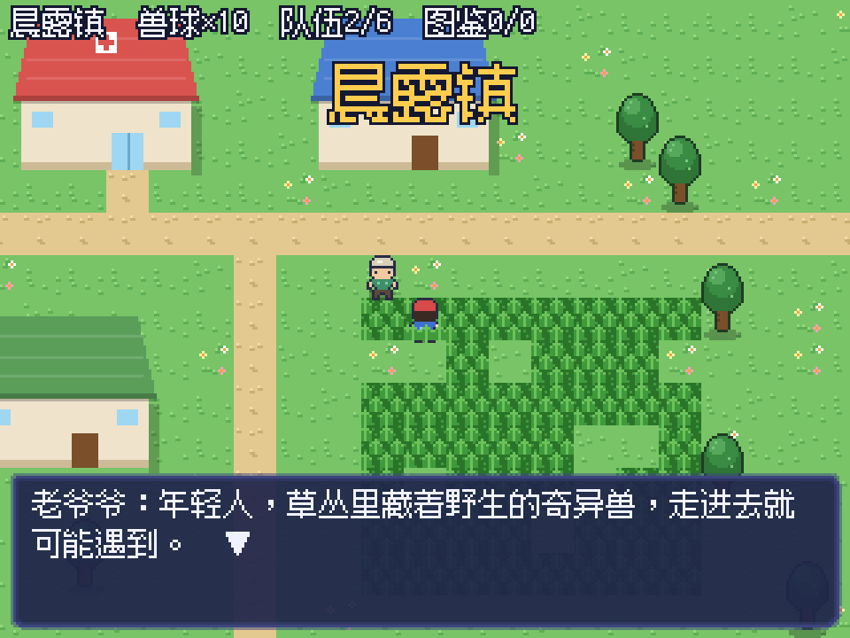
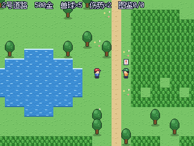
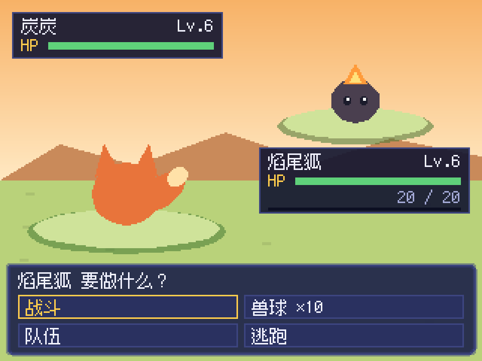

# 幻兽

一款类 PokeMMO 的 2.5D 俯视角怪兽收集 RPG，用 Godot 4 开发。当前是单机可玩的最小版本。画面以 320×240 渲染再整数倍放大，地面、树、人物、房屋和幻兽都是像素图。





## 运行

1. 安装 [Godot 4.3](https://godotengine.org/download)（标准版即可，不需要 .NET 版）。
2. 打开 Godot，导入本仓库根目录下的 `project.godot`。
3. 按 F5 运行。

| 操作 | 按键 |
| --- | --- |
| 移动 | WASD / 方向键 |
| 奔跑 | 按住 Shift |
| 对话、确认 | 空格 / Z / 回车 |
| 菜单（队伍、背包） | X / Esc |

## 目前有什么

- 奈尔斯地区：14080×14080 格的大地图，按 16×16 区块确定性生成（`scripts/world/world_gen.gd`），只加载玩家附近的区块
- 9 种地貌：草原、森林、沼泽、海岸、沙漠、火山、山地、湖区、雪原，各有自己的地面、树木、岩石、高草、湖泊/熔岩/冰面和地面装饰，四周是奈尔斯海
- 19 个城镇（8 座道馆城市、9 个村镇、起始的晨露镇和幻兽联盟）、22 条道路、12 个洞窟和地标，全部在 `tools/world_plan.py` 里规划，详见 `docs/world-plan.md`
- 地形用自动拼接图块：地面之间有过渡边，水、熔岩、沼泽有动画，道路跨水自动架桥
- 树木、房屋、NPC 按 Y 排序遮挡（2.5D 效果）
- 走进高草有 12% 概率遇到野生幻兽，物种按地貌、等级按区域决定
- 14 种幻兽（带立体光影的像素立绘），火、水、草、电、普通五种属性，属性克制、本系加成、会心一击、按速度决定先后手
- 战斗有像素背景（每条道路一张），出招时会前冲，五种属性各有命中特效
- 进化：三只御三家 16 级进化，圆滚鸟 14 级，绒绒虫 → 茧茧 → 彩翼蝶
- 兽球捕捉（血越少越好抓）、6 只队伍上限、存储箱
- 经验、升级、学新招式
- 金钱：打赢野生幻兽和训练师都有赏金；商店（晨露镇蓝顶房子）卖兽球和伤药，战斗中和菜单里都能用伤药
- 训练师对战：2 号道路的阿杰站在路边，走进他的视线就会被拦下，不能逃跑也不能捕捉，打赢有 1.5 倍经验和赏金
- 治疗所恢复、NPC 对话、自动存档（`user://save.json`）。全灭后会被送回治疗所

## 目录结构

```
project.godot
scenes/main.tscn          主场景（只挂了 main.gd，其余节点在代码里创建）
scripts/
  game.gd                 全局状态（自动加载为 Game）：队伍、道具、图鉴、存档、按键
  data.gd                 招式、属性克制、物种与进化、遭遇表、商店
  monster.gd              幻兽实例：能力值、升级、进化、序列化
  art.gd                  读取并绘制像素图（人物、树、房屋、幻兽）
  main.gd                 主流程：行走 / 对话 / 战斗 / 菜单 切换
  world/world.gd          地图生成与地面绘制，Y 排序物件层
  world/player.gd         网格移动的玩家与相机
  world/prop.gd           树、房屋、NPC
  battle/battle.gd        战斗逻辑
  battle/battle_view.gd   战斗画面绘制
  ui/dialog_box.gd        对话框与选项按钮
  ui/hud.gd               状态栏与地名提示
assets/sprites/           像素图：tiles.png 地面图块、tree.png、house_*.png、人物行走图、monsters/ 幻兽正背面
assets/fonts/             Fusion Pixel 12px 中文像素字体（SIL OFL 1.1，见 OFL.txt）
tools/gen_pixel_art.py    重新生成 assets/sprites 下的像素图（需要 Pillow）
tools/gen_monsters.py     幻兽像素图的形状定义与光照渲染，由 gen_pixel_art.py 调用
tools/gen_battle_bg.py    战斗背景，由 gen_pixel_art.py 调用
tests/smoke_test.tscn     冒烟测试
tests/screenshot.tscn     截图脚本（CI 用虚拟显示器运行，截图作为构建产物上传）
tests/map_overview.tscn   导出奈尔斯地区全图鸟瞰图（每 16 格一个像素）
```

## 美术规格

- 渲染分辨率 320×240，窗口 960×720，整数倍缩放，关闭纹理过滤
- 图块 16×16。`tiles.png` 一行依次是：草地、草地变体、花、高草、小路、水面三帧、高草前景
- 人物行走图每帧 16×20，3 列（站立、迈左脚、迈右脚）× 4 行（下、左、右、上）
- 树 16×32，原点在底边中心
- 房屋 72×60（`house_heal.png` 治疗所、`house_shop.png` 商店、`house_home.png` 民居），图片左下角往里 4 像素对齐房屋占地的左下角
- 幻兽正面 72×72、背面 96×96（`monsters/<物种>_front.png` / `_back.png`），脚底在底边往上 5 像素的中心。生成器把形状当成立体来打光（左上前方光源、5 级色阶、暗部偏冷亮部偏暖），再加投影、内外轮廓、眼睛高光
- 战斗背景 320×240（`battle_bg_<道路序号>.png`），站台中心对手在 (236, 82)、自己在 (84, 154)
- 字体只用 12px（或 24px 等整数倍），否则像素会糊

换手绘图时保持同样的尺寸和排布，代码不用改。

## 测试

每次推送，GitHub Actions 会下载 Godot 4.3，在无头模式下导入项目并运行冒烟测试（数据公式、进化、商店与伤药、存档读写、主场景加载、训练师视线、自动打完野生和训练师战斗各一场）。本地运行：

```
godot --headless --path . res://tests/smoke_test.tscn
```

## 路线图

1. **美术**：更丰富的招式动画、地图改用 TileMapLayer 方便在编辑器里画、换成手绘像素图
2. **内容**：第二个城镇和道馆、更多训练师和物种、更多道具
3. **系统**：状态异常、能力等级变化、特性、图鉴界面
4. **联机**（单机打磨好之后）：同屏看到其他玩家、交易、玩家对战。届时需要单独的服务器
